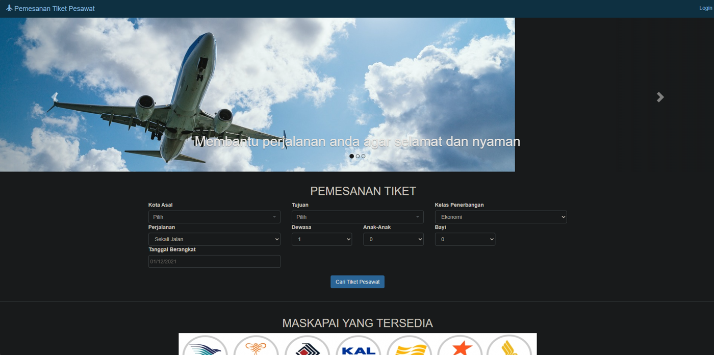
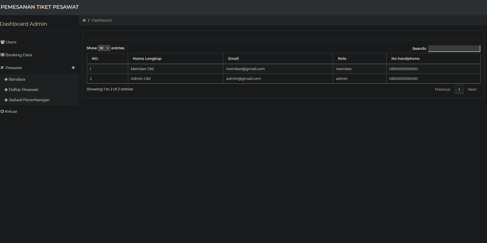
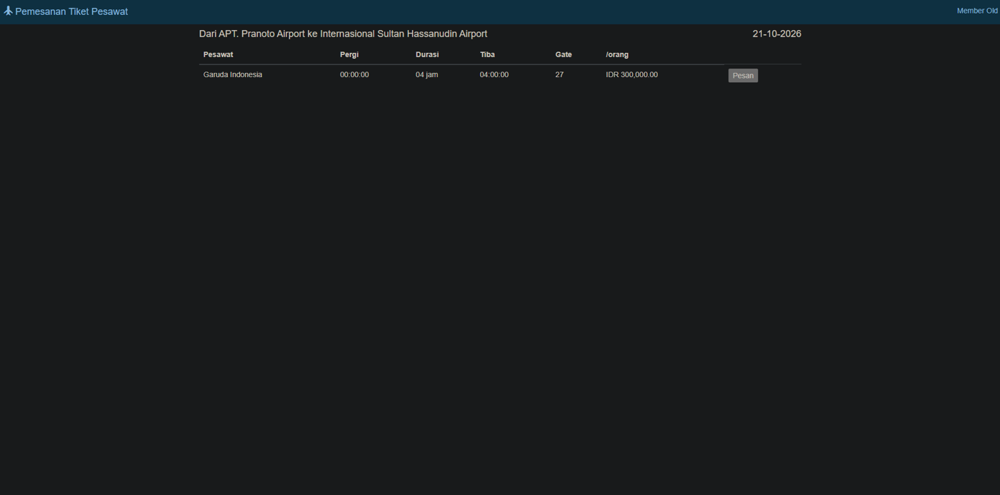

# ✈️ Tiket Pesawat Online

Aplikasi web pemesanan tiket pesawat berbasis **Laravel 8** dan **MySQL**. Pengguna bisa mencari jadwal penerbangan, memesan tiket sekali jalan atau pulang-pergi, membayar lewat transfer bank, dan mengunduh e-tiket. Admin mengelola pesawat, bandara, jadwal, dan pesanan.

## Preview

| Halaman Utama | Dashboard Admin | E-Tiket Member |
|---|---|---|
|  |  |  |

## Fitur

**Pengguna (member)**
- Registrasi dengan verifikasi email, login, dan ubah profil/password
- Cari penerbangan berdasarkan kota asal, tujuan, dan tanggal
- Pesan tiket sekali jalan atau pulang-pergi dengan kelas Ekonomi, Bisnis, atau First
- Isi data penumpang, bayar via transfer bank, lalu lihat riwayat pesanan dan e-tiket

**Admin**
- Kelola data pengguna dan pesanan
- CRUD pesawat beserta tarif per kelas
- CRUD bandara dan jadwal penerbangan
- Trigger database untuk mengembalikan kursi saat pesanan dihapus

## Teknologi

Laravel 8 · PHP 7.3+/8 · MySQL · Blade · Bootstrap · Laravel UI (auth) · jrean/laravel-user-verification

## Menjalankan di komputer lokal (XAMPP)

```bash
git clone https://github.com/Axcels81/tiket-pesawat-online.git
cd tiket-pesawat-online
composer install
cp .env.example .env
php artisan key:generate
```

1. Buat database `tiket_pesawat` di phpMyAdmin, lalu impor `tiket_pesawat_demo.sql`.
2. Sesuaikan `DB_DATABASE`, `DB_USERNAME`, dan `DB_PASSWORD` di file `.env`.
3. Jalankan `php artisan serve` lalu buka http://localhost:8000.

**Akun demo:** `member@gmail.com` (member) dan `admin@gmail.com` (admin). Password keduanya: `demo1234`.

## Struktur singkat

| Folder | Isi |
|---|---|
| `app/Http/Controllers` | Logika booking, admin, user, pesawat, bandara |
| `resources/views` | Halaman Blade (booking, admin, user, auth) |
| `database/migrations` | Struktur tabel dan trigger |
| `routes/web.php` | Daftar rute aplikasi |

---
Dibuat oleh **Ahmad Hadi Sahab** · [Portofolio](https://axcels81.github.io)
